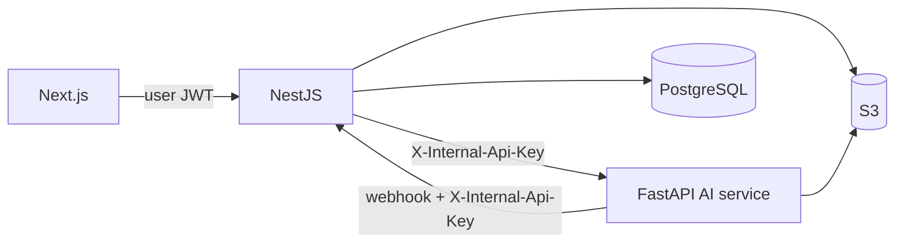
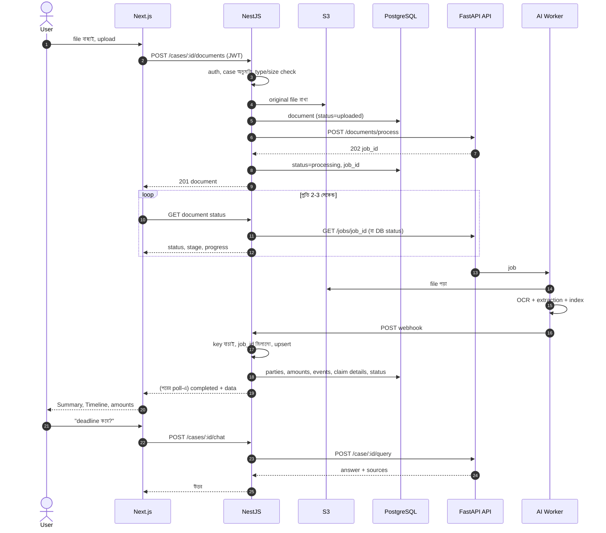

# Integration Guide — Case AI Service ↔ NestJS ↔ Next.js

এই document-এ আছে: (ক) কে কার সাথে কথা বলে, (খ) NestJS developer-কে পাঠানোর message, (গ) Next.js developer-কে পাঠানোর message, (ঘ) পুরো workflow, (ঙ) contract ও code snippet, (চ) integration test checklist।

সব technical contract-এর একমাত্র সত্য উৎস: **`docs/openapi.json`** এবং **`docs/examples/*.json`**।

---

## ক) কে কার সাথে কথা বলে



> **Next.js কখনও FastAPI-কে সরাসরি call করে না।** User-এর login, case-এর অধিকার যাচাই, সব NestJS-এর দায়িত্ব। FastAPI শুধু NestJS-কে বিশ্বাস করে। তাই "Next.js dev আমাকে কী দেবে" প্রশ্নের উত্তর: আমার service-এর সাথে Next.js-এর কোনো সরাসরি লেনদেন নেই। আমি যা দেব ও নেব তা সব **NestJS developer**-এর সাথে। Next.js dev-এর সাথে আমার যোগাযোগ শুধু "UI-এর কোন তথ্য দরকার" ঠিক করা (§গ), যাতে NestJS সেই তথ্য expose করে।

**দায়িত্বের ছক**

| কাজ | Next.js | NestJS | FastAPI (আমার) |
|---|---|---|---|
| Upload UI, progress, extracted তথ্য, Timeline, chat UI | ✅ | | |
| Auth, case অনুমতি | | ✅ | |
| File আপলোড → S3, `documents` record | | ✅ | |
| `POST /documents/process` call | | ✅ | |
| OCR, extraction, embedding, RAG | | | ✅ |
| Webhook গ্রহণ, DB-তে save, Timeline তৈরি | | ✅ | |
| Document/Case মুছলে `DELETE …/index` call | | ✅ | |
| User-এর সামনে status/error বার্তা | ✅ | ✅ (mapping) | |

---

## খ) NestJS developer-কে পাঠানোর message (copy-paste)

> **বিষয়: AI Document Processing service — integration তথ্য ও আপনার কাছ থেকে যা যা লাগবে**
>
> ভাই, AI/OCR/extraction অংশ (FastAPI `case-ai-service`) তৈরি। আপনার দিক থেকে integration-এ শুধু ৩টা কাজ: (১) upload-এর পর আমাদের API call করা, (২) একটা webhook endpoint বানানো, (৩) document/case মুছলে vector মোছার call করা। বিস্তারিত নিচে।
>
> **১. Service চালানো:** repo-র `README.md` দেখুন: `cp .env.example .env && docker compose up --build` → `http://localhost:8000/docs` (Swagger)। Contract: `docs/openapi.json`, উদাহরণ: `docs/examples/`।
>
> **২. Auth:** সব request-এ header `X-Internal-Api-Key: <shared secret>`। Service internet-এ খোলা রাখবেন না; শুধু আপনার backend network থেকে access।
>
> **৩. Upload-এর পর call:**
> `POST {AI_BASE_URL}/api/v1/documents/process` — body:
> ```json
> { "document_id": "…", "case_id": "…", "s3_bucket": "…", "s3_key": "…",
>   "file_type": "pdf", "callback_url": "https://<nestjs-host>/internal/documents/<document_id>/processing-result",
>   "metadata": { "request_id": "…" } }
> ```
> Response `202 { job_id, status: "queued", deduplicated }`। `job_id` আপনার `documents` table-এ রাখুন এবং status `processing` করুন। একই `document_id`-র job চললে আমরা নতুন বানাই না, আগেরটাই ফেরত দিই (`deduplicated: true`), তাই retry নিরাপদ।
> `file_type` শুধু hint (আসল type আমরা file দেখে বের করি)। `callback_url` না দিলে শুধু polling।
>
> **৪. Webhook (আপনার endpoint):** কাজ শেষে/ব্যর্থ হলে আমরা `POST callback_url` করব। Headers: `X-Internal-Api-Key`, `Idempotency-Key` (= `job_id`), ঐচ্ছিক `X-Signature: sha256=<HMAC-SHA256(raw body)>`। Body-র নমুনা: `docs/examples/webhook_payload.example.json`।
> আপনাকে যা করতে হবে:
> - key যাচাই; `payload.job_id` আপনার `documents.job_id`-র সাথে না মিললে (পুরনো job) উপেক্ষা করে `200` দিন
> - **`(document_id, ref)` দিয়ে upsert** করুন (`ref` পুনরায় process করলেও একই থাকে, duplicate হবে না)
> - `status: "completed"` হলেও `extracted_data.processing_status` `partial` হতে পারে (কিছু page পড়া যায়নি)। `warnings` সংরক্ষণ করুন
> - `status: "failed"` হলে `error_code` + `error` দিয়ে document `failed` করুন (কোড তালিকা `docs/ARCHITECTURE.md` §৮.৭)
> - দ্রুত `2xx` দিন। ভেতরে ভুল হলে `5xx` দিন, আমরা backoff সহ ৫ বার চেষ্টা করব। `4xx` (429/408 ছাড়া) দিলে আমরা আর চেষ্টা করব না
> - Webhook duplicate আসতে পারে, তাই idempotent রাখুন
>
> **৫. Polling fallback:** `GET /api/v1/documents/jobs/{job_id}` → `status, stage, progress(0-100), warnings, result, callback_status`। Frontend-এর progress bar-এর জন্যও এটা কাজে লাগবে (আপনি নিজের API দিয়ে expose করবেন)। Webhook miss হলে (যেমন ২–৩ মিনিটেও `completed` না এলে) একটা reconcile job দিয়ে poll করুন।
>
> **৬. মোছার সময়:** Document মুছলে `DELETE /api/v1/documents/{document_id}/index`, case মুছলে `DELETE /api/v1/case/{case_id}/index`। না করলে মোছা তথ্য AI-র উত্তরে আসতে পারে।
>
> **৭. RAG (case নিয়ে প্রশ্ন):** আপনার endpoint (যেমন `POST /cases/:id/chat`) user-এর অধিকার যাচাই করে `POST /api/v1/case/{case_id}/query` call করবে: `{ "question": "…", "history": [{role, content}], "document_ids": [optional] }` → `{ answer, answerable, sources: [{document_id, page, chunk_text_snippet, score}] }`। শুধু ঐ case-এর তথ্যই ফেরত আসে।
>
> **৮. আপনার কাছ থেকে যা যা লাগবে** (এগুলো ছাড়া আমি real test করতে পারছি না):
> - [ ] AWS: S3 bucket নাম + region; IAM user/role: `s3:GetObject` (bucket-এ) + Textract (`DetectDocumentText`, `StartDocumentTextDetection`, `GetDocumentTextDetection`); bucket KMS-encrypted হলে `kms:Decrypt`। **Client-এর নিজের account** (proposal অনুযায়ী)
> - [ ] OpenAI API key (client-এর account); কোন model চান তা নিশ্চিত করুন
> - [ ] `INTERNAL_API_KEY` (দুই পক্ষের shared secret, লম্বা random) এবং চাইলে `WEBHOOK_SIGNING_SECRET`
> - [ ] Webhook URL, যেটা আমাদের worker-এর network থেকে পৌঁছানো যায় (Docker network/VPC/hostname)। Production-এ `CALLBACK_ALLOWED_HOSTS`-এ এর host দেব
> - [ ] Deployment কোথায় হবে (একই docker network? আলাদা server?), FastAPI-র `AI_BASE_URL` কী হবে
> - [ ] **৫–১০টা আসল নমুনা document** (text PDF, scanned PDF, ছবি, mixed; ব্যক্তিগত তথ্য মুছে হলেও চলবে)। AI-র মান এগুলো দিয়েই tune হবে
> - [ ] আপনার document status-এর নাম/enum (আমি `queued|processing|completed|failed` ব্যবহার করি, mapping ঠিক করুন)
>
> **৯. আমি দিচ্ছি:** পুরো code + Docker, `openapi.json`, উদাহরণ payload, `requests.http` (VS Code REST Client), সব ৭০+ test। Dev endpoint `POST /api/v1/dev/process-upload` দিয়ে আপনার S3 ছাড়াই file দিয়ে test করা যায় (`ENVIRONMENT=production`-এ বন্ধ থাকে)।

---

## গ) Next.js developer-কে পাঠানোর message (copy-paste)

> **বিষয়: AI extraction-এর data ও UI-তে কী দেখাতে হবে**
>
> ভাই, AI অংশ তৈরি। আপনার UI FastAPI-র সাথে কথা বলবে না, সব NestJS-এর মাধ্যমে। নিচে বলছি AI থেকে কী তথ্য পাওয়া যাবে এবং UI-তে কী কী state সামলাতে হবে। NestJS developer-এর সাথে বসে ঠিক করুন কোন API path/নামে এগুলো expose হবে।
>
> **১. Document-এর অবস্থা (upload-এর পর):**
>
> | Backend status | মানে | UI |
> |---|---|---|
> | `uploaded` | ফাইল গেছে, প্রক্রিয়া শুরু হয়নি | "আপলোড হয়েছে" |
> | `queued` / `processing` | চলছে; `progress` 0–100 এবং `stage` আছে | Progress bar + ধাপের নাম |
> | `completed` | সফল, তথ্য পাওয়া যাবে | ফলাফল দেখান |
> | `completed` + `partial` | কিছু page/অংশ পড়া যায়নি (`warnings` আছে) | ফলাফল + হলুদ সতর্কতা "কিছু পাতা পড়া যায়নি" |
> | `failed` | ব্যর্থ; `error_code` আছে | লাল বার্তা + আবার আপলোডের বোতাম |
>
> `stage` → ব্যবহারকারীর ভাষা: `queued` "অপেক্ষায়" · `fetching_file` "ফাইল আনা হচ্ছে" · `extracting_text` "লেখা পড়া হচ্ছে (OCR)" · `indexing_and_extracting` "তথ্য বের করা হচ্ছে" · `retrying` "আবার চেষ্টা চলছে" · `sending_callback`/`done` "প্রায় শেষ"।
> Progress ও status update-এর জন্য প্রক্রিয়া চলাকালীন প্রতি ২–৩ সেকেন্ডে poll করুন (বা NestJS SSE/websocket দিলে সেটা)। `completed`/`failed` হলে poll বন্ধ। সময় document-এর ধরন ও OpenAI/Textract-এর গতির উপর নির্ভর করে: ছোট text PDF-এ কয়েক সেকেন্ড, বড় scanned PDF-এ কয়েক মিনিট (আনুমানিক; আসল account-এ এখনও মাপা হয়নি)।
>
> **২. প্রতিটা document থেকে যে তথ্য আসবে** (নমুনা `docs/examples/webhook_payload.example.json`):
>
> | তথ্য | UI-তে |
> |---|---|
> | `document_type`, `summary` | Document card-এ ধরন (badge) + ৩–৫ লাইনের সারাংশ |
> | `claim_details` (claim no., policy no., insurer, insured, date of loss, loss location, vehicle) | "Case তথ্য" panel |
> | `parties[]` (নাম, role, প্রতিষ্ঠান, যোগাযোগ) | Party তালিকা/role অনুযায়ী ভাগ |
> | `events[]` (title, `event_date`, `date_text`, `event_type`, `is_deadline`) | **Timeline** |
> | `amounts[]` (label, amount, currency, `amount_type`) | Amount টেবিল, ধরন অনুযায়ী (deductible, estimate…) |
> | `requests[]` (কী করতে বলা হয়েছে, কে, `due_date`) | "করণীয়" তালিকা |
> | প্রতিটা item-এ `evidence {page, quote}` | **"Page 2" লিংক**: PDF viewer সেই পাতায় খুলুন, quote highlight/tooltip |
> | প্রতিটা item-এ `confidence`, `grounded` | নিচে §৪ |
> | `warnings[]` | Document-এর নিচে ছোট সতর্কতা |
>
> **৩. Timeline-এর নিয়ম:**
> - `event_date` (YYYY-MM-DD) আছে এমন event তারিখ অনুযায়ী সাজান। **`is_deadline: true` আলাদা রঙ/আইকন** (লাল/কমলা), অতিক্রান্ত হলে "মেয়াদ শেষ", ৭ দিনের মধ্যে হলে "শীঘ্রই"
> - শুধু `date_text` আছে (যেমন "within 30 days of this letter") কিন্তু `event_date` নেই: Timeline-এ নয়, আলাদা "তারিখ অনিশ্চিত" তালিকায়
> - একাধিক document থেকে event এক Timeline-এ মিশবে; প্রতিটা event-এ source document ও page দেখান
> - Event-এর `event_type` (accident, deadline, request, notice, payment, treatment, inspection, filing, correspondence, other) দিয়ে আইকন
>
> **৪. AI ভুল করতে পারে, তাই "review" চিহ্ন:** `grounded: false` অথবা `confidence < 0.6` হলে item-এর পাশে "যাচাই করুন" badge। NestJS-এর সাথে ঠিক করুন user কি item edit/confirm/reject করতে পারবে (আমি সুপারিশ করি: পারবে, এবং edited item পুনরায় process-এ overwrite হবে না)।
>
> **৫. Error বার্তা** (`error_code` অনুযায়ী): `UNSUPPORTED_FILE_TYPE` "এই ধরনের ফাইল সমর্থিত নয়" · `ENCRYPTED_DOCUMENT` "পাসওয়ার্ড সরিয়ে আবার আপলোড করুন" · `NO_READABLE_TEXT` "লেখা পড়া যায়নি, পরিষ্কার scan দিন" · `FILE_TOO_LARGE` / `TOO_MANY_PAGES` "ফাইল অনেক বড়" · `CORRUPT_DOCUMENT` "ফাইল খোলা যাচ্ছে না" · বাকি সব (transient) "সাময়িক সমস্যা, আবার চেষ্টা করুন"। পূর্ণ তালিকা `docs/ARCHITECTURE.md` §৮.৭।
>
> **৬. সমর্থিত ফাইল (upload validation-এ):** PDF, JPG/JPEG, PNG, TIFF, DOCX, TXT; সর্বোচ্চ ৫০ MB, ৩০০ পাতা (client-এর সাথে চূড়ান্ত করুন)। Text PDF, scanned PDF, ছবি, mixed সব চলে।
>
> **৭. Case নিয়ে প্রশ্ন (chat, Milestone-এর stretch):** NestJS-এর chat endpoint call করবেন। উত্তর: `{ answer, answerable, sources[{document_id, page, chunk_text_snippet}] }`। `answerable: false` হলে "ডকুমেন্টে এর উত্তর পাওয়া যায়নি" দেখান। প্রতিটা উত্তরের নিচে source ("Page 2, Document X") ক্লিক করলে document খুলবে। Follow-up প্রশ্নে আগের কয়েকটা কথোপকথন (`history`) সহ পাঠান।
>
> **৮. আমার কাছে আপনার যা জানানো দরকার** (contract ফ্রিজ করার আগে; পরে বদলানো কঠিন):
> - [ ] UI-তে এমন কোনো তথ্য লাগবে যা উপরের তালিকায় নেই? (যেমন highlight-এর bounding box লাগলে বলুন: এখন শুধু page + quote দিচ্ছি)
> - [ ] কোন কোন document type আসবে (police report, medical bill…)? নতুন type লাগলে schema-তে যোগ করব
> - [ ] Document/case মুছলে বা user item edit করলে NestJS-এর সাথে আপনার প্রত্যাশা

---

## ঘ) পুরো workflow (User থেকে User পর্যন্ত)



---

## ঙ) Contract ও code snippet

### ঙ.১ Process request/response

`docs/examples/process_request.example.json` দেখুন। Response:
```json
{ "job_id": "8f14e45f…", "status": "queued", "document_id": "doc-1001", "deduplicated": false }
```

### ঙ.২ Job status (`GET /api/v1/documents/jobs/{job_id}`)
```json
{ "job_id": "…", "document_id": "…", "case_id": "…",
  "status": "processing", "stage": "indexing_and_extracting", "progress": 62, "attempts": 1,
  "result": null, "chunks_indexed": null, "error": null, "error_code": null,
  "warnings": [], "callback_status": "pending" }
```
`completed`/`failed` হলে `result` ভরা থাকে (webhook-এর `extracted_data`-র সমান)।

### ঙ.৩ NestJS: AI call (TypeScript)
```ts
// ai.client.ts
import axios from 'axios';

const ai = axios.create({
  baseURL: process.env.AI_BASE_URL,            // e.g. http://case-ai-api:8000
  headers: { 'X-Internal-Api-Key': process.env.AI_INTERNAL_API_KEY! },
  timeout: 15_000,
});

export async function startProcessing(doc: { id: string; caseId: string; bucket: string; key: string; ext: string }) {
  const { data } = await ai.post('/api/v1/documents/process', {
    document_id: doc.id,
    case_id: doc.caseId,
    s3_bucket: doc.bucket,
    s3_key: doc.key,
    file_type: doc.ext,
    callback_url: `${process.env.PUBLIC_INTERNAL_URL}/internal/documents/${doc.id}/processing-result`,
  });
  return data as { job_id: string; status: string; deduplicated: boolean };
}
```

### ঙ.৪ NestJS: Webhook controller (সারমর্ম)
```ts
@Controller('internal/documents')
export class ProcessingWebhookController {
  @Post(':documentId/processing-result')
  @HttpCode(200)
  async handle(@Param('documentId') documentId: string,
               @Headers('x-internal-api-key') key: string,
               @Body() payload: ProcessingResultDto) {
    if (key !== process.env.AI_INTERNAL_API_KEY) throw new UnauthorizedException();
    const doc = await this.docs.findOneOrFail(documentId);
    if (doc.jobId !== payload.job_id) return { ignored: 'stale job' };   // পুরনো job

    if (payload.status === 'failed') {
      await this.docs.markFailed(documentId, payload.error_code, payload.error);
      return { ok: true };
    }
    await this.db.transaction(async (tx) => {
      const d = payload.extracted_data;
      await upsertByRef(tx.events,   documentId, d.events);     // key: (document_id, ref)
      await upsertByRef(tx.amounts,  documentId, d.amounts);
      await upsertByRef(tx.parties,  documentId, d.parties);
      await upsertByRef(tx.requests, documentId, d.requests);
      await tx.documents.update(documentId, {
        status: d.processing_status === 'partial' ? 'partial' : 'completed',
        docType: d.document_type, summary: d.summary, claimDetails: d.claim_details,
        warnings: d.warnings, pages: d.pages, chunksIndexed: payload.chunks_indexed,
      });
      // আগের process-এর যে item এবার নেই এবং user edit করেনি -> মুছুন
    });
    return { ok: true };
  }
}
```
(Raw body দিয়ে `X-Signature` যাচাই করতে চাইলে Nest-এ `rawBody: true` চালু করুন।)

### ঙ.৫ প্রস্তাবিত PostgreSQL গঠন (NestJS developer-এর জন্য সুপারিশ)

| Table | মূল column | Unique |
|---|---|---|
| `documents` | id, case_id, s3_bucket, s3_key, original_name, size, `status`, `stage`, `progress`, `job_id`, `doc_type`, `summary`, `claim_details` jsonb, `warnings` jsonb, `pages` jsonb, `error_code`, `error_message`, processed_at | |
| `case_events` (Timeline) | id, case_id, document_id, `ref`, title, description, `event_date` date null, `date_text`, `event_type`, `is_deadline`, `source_page`, `source_quote`, `confidence`, `grounded`, `review_status` (auto/confirmed/edited/rejected) | `(document_id, ref)` |
| `extracted_amounts` | …label, amount numeric(14,2), currency, amount_type, source_page, source_quote, confidence, grounded, ref | `(document_id, ref)` |
| `extracted_parties` | …name, role, organization, contact, source_page, source_quote, confidence, ref | `(document_id, ref)` |
| `action_requests` | …description, requested_by, due_date, source_page, source_quote, confidence, ref | `(document_id, ref)` |

Traceability (client-এর acceptance criteria): প্রতিটা item → `document_id` + `source_page` + `source_quote`; Timeline event → একই source।

### ঙ.৬ Next.js: TypeScript type (সারমর্ম)
```ts
type Evidence = { page: number | null; quote: string | null };
type CaseEvent = {
  ref: string; title: string; description: string;
  event_date: string | null; date_text: string | null;
  event_type: 'accident'|'deadline'|'request'|'notice'|'payment'|'treatment'|'inspection'|'filing'|'correspondence'|'other';
  is_deadline: boolean; evidence: Evidence; confidence: number; grounded: boolean;
};
type DocStatus = 'uploaded'|'queued'|'processing'|'completed'|'partial'|'failed';
```
সব type `docs/openapi.json` থেকে generate করা যায়: `npx openapi-typescript docs/openapi.json -o ai-types.ts`।

---

## চ) Integration test checklist (NestJS ↔ FastAPI প্রথম যোগাযোগে)

1. [ ] `GET {AI}/health` → `{"status":"ok"}` (Redis + Qdrant দুটোই `ok`)
2. [ ] ভুল key দিয়ে `POST /documents/process` → `401`
3. [ ] সঠিক key + আসল S3 key → `202` ও `job_id`
4. [ ] `GET /jobs/{id}` বারবার → `progress` বাড়ছে → `completed`
5. [ ] NestJS webhook-এ payload এসেছে; `Idempotency-Key == job_id`; DB-তে events/amounts/parties সংরক্ষিত
6. [ ] **একই document আবার process** → DB-তে duplicate হয়নি (`ref` upsert)
7. [ ] Scanned PDF ও ছবি → `pages[].method == "ocr"`, text এসেছে
8. [ ] Mixed PDF → কিছু page `text`, কিছু `ocr`
9. [ ] ভুল S3 key → `failed`, `error_code: FILE_NOT_FOUND`, webhook এসেছে
10. [ ] Unsupported ফাইল → `UNSUPPORTED_FILE_TYPE`
11. [ ] Webhook endpoint বন্ধ রেখে process → `callback_status: "failed"`, কিন্তু `GET /jobs/{id}`-এ `result` আছে (polling fallback কাজ করছে)
12. [ ] `POST /case/{id}/query` → উত্তর + source page; অন্য case-এর তথ্য আসে না
13. [ ] Document মুছে `DELETE …/index` → RAG-এ আর আসে না

---

## ছ) সাধারণ প্রশ্ন

- **Webhook আর polling দুটোই কেন?** Webhook দ্রুত ও সরল, কিন্তু network ব্যর্থ হতে পারে। Polling হলো নিরাপত্তা-জাল; result Redis-এ ৭ দিন থাকে।
- **কত সময় লাগে?** আনুমানিক: text PDF-এ কয়েক সেকেন্ড; scanned কয়েক page-এ এক মিনিটের মতো; বড় scanned PDF (১৫+ page) কয়েক মিনিট। এগুলো মাপা সংখ্যা নয়, আসল OpenAI/Textract account-এ চালিয়ে মাপতে হবে।
- **Reprocess কিভাবে?** একই `document_id` দিয়ে আবার `process` call (চাইলে `force_reprocess: true`, না দিলে OCR cache ব্যবহার হয়)।
- **User-এর edit করা তথ্য?** Reprocess-এ overwrite এড়াতে NestJS-এ `review_status = edited/confirmed` থাকা item বাদ দিয়ে upsert করুন।
- **Schema বদলালে?** Payload-এ `schema_version` আছে (এখন `"1.0"`)। নতুন field যোগ হলে NestJS যেন অজানা field উপেক্ষা করে।
